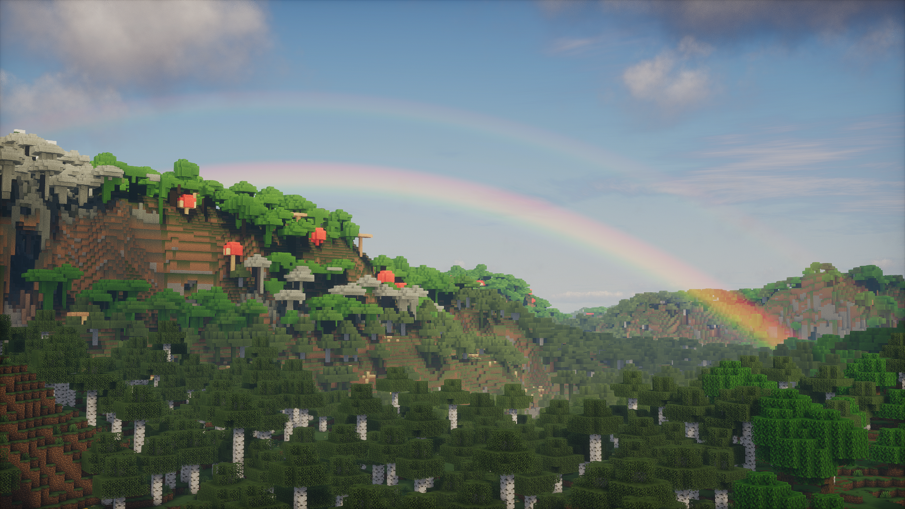

<h1 align = "center">Din Concept 1.0</h1>

A cinematic End (and night sky) for Photon - a child of IterationT and Photon

Din Concept is an unofficial edit of [Photon Shaders](https://github.com/sixthsurge/photon) by SixthSurge. It
started as a for-fun test with AI assistants (Claude and ChatGPT) and grew into a full rework of the End's sky,
inspired by the IterationT shader's End and built on Photon's own pipeline. Everything outside the sky objects is
Photon, updated to the latest Photon main.

### What it adds

**The End**
* A black hole with gravitational lensing, an accretion disc and a bright photon ring; it bends the stars
  and the nebula behind it and slowly pulls nearby gas in
* A planet on its own orbit, which can eclipse the black hole (and dim its light when it does)
* The Eagle Nebula (M16) around the island in the Hubble palette, a nebula sea below the island, close wisps and
  drifting cosmic dust; Frame Accumulation keeps it sharp and a Quality slider trades detail for FPS
* An Enhanced Star Field (dense, coloured, lensed) and shooting stars
* Environmental Light: the black hole lights the island and casts shadows (the obsidian pillars' long shadows),
  with volumetric light rays between the pillars
* Two sky styles: Photon Concept (Photon's purple End with the new objects, default) and Cinematic Void (a dark
  deep-space End)
* A cinematic End portal: Minecraft's layered portal in the End's colours with real depth, glints, and (with
  Colored Lights) a warm light and a mist rising out of it - in strongholds and on the End's exit portal
* Colour options for the nebula, its sea and the black hole; cave light in the End

**The Overworld** (each object can be set to End only / Overworld only / both)
* The planet becomes the moon, with the moon's phases
* The black hole in the sky, by night and (fainter, behind the blue) by day
* The Enhanced Star Field, shooting stars and a Milky Way in the nebula's colours at night

All options are in the **Din Concept** menu.

### Credits
* **Photon Shaders** by SixthSurge - the whole shader this is built on (license below and in LICENSE)
* **IterationT** - the inspiration for the End's black hole, planet and stars
* Made with Claude (Anthropic) and ChatGPT (OpenAI)

Not affiliated with or endorsed by SixthSurge. Please report Din Concept issues to its author, not to Photon.

---

  

<h1 align = "center">Photon Shaders</h1>

A gameplay-focused shader pack for Minecraft

## Acknowledgments

* Menu translations: 
  * [NakiriRuri](https://github.com/NakiriRuri) and [OrzMiku](https://github.com/Orzmiku) - Chinese Simplified (China; Mandarin)
  * [ChunghwaMC](https://github.com/ChunghwaMC) - Chinese Traditional (Taiwan; Mandarin)
  * [Jmayk](https://github.com/Jmayk-dev) - Italian
  * [Timtaran](https://github.com/Timtaran) - Russian
  * [shihyeon](https://github.com/shihyeon) - Korean
  * [DVRKHz](https://github.com/DVRKHz) - Spanish
  * [Patatagod69](https://github.com/PatataNL) - Dutch
  * sincerity - Estonian
* [Emin](https://github.com/EminGT) - Shadow bias method from [Complementary Reimagined](https://www.complementary.dev/shaders/) (fully fixes peter panning and light leaking underground!)
* [DrDesten](https://github.com/DrDesten) - Depth tolerance calculation for SSR (helps to prevent false reflections)
* [Essentuan](https://github.com/Essentuan) - Photonics mod support
* [Jessie](https://github.com/Jessie-LC) - f0 and f82 values for labPBR hardcoded metals
* [Sledgehammer Games](https://www.sledgehammergames.com/) - Bloom downsampling method used in Call of Duty Advanced Warfare (described [here](http://www.iryoku.com/next-generation-post-processing-in-call-of-duty-advanced-warfare))
* http://momentsingrapics.de/ - Blue noise texture
* [NASA Scientific Visualization Studio](https://svs.gsfc.nasa.gov/4851) - Galaxy image

## Installation

* Photon can be used with [Iris](https://irisshaders.dev/download) (recommended) or [OptiFine](https://optifine.net/home)
* Iris is a modern shader loader with far better performance, mod compatibility and developer features than OptiFine. Some features (Colored Lighting) will only work on Iris
* Once you have your preferred shader loader installed, simply place the downloaded zip file in your `.minecraft/shaderpacks` folder

### Downloads
* [Releases](https://modrinth.com/shader/photon-shader/versions) (recommended)
* [Lastest commit](https://github.com/sixthsurge/photon/archive/refs/heads/main.zip)

## Features
* Fully revamped sky, lighting and water 
* Detailed clouds with many layers and cloud types
* Immersive weather system providing different skies each day
* Voxel-based colored lighting (enabled with Ultra profile, requires Iris)
* Screen-space reflections
* Volumetric fog
* Soft shadows with variable-size penumbras
* Detailed ambient occlusion (GTAO)
* Camera effects: bloom, depth of field, motion blur
* Much improved image quality with TAA, FXAA and CAS
* Advanced temporal upscaling (disabled by default) for low end devices
* Extensive settings menu allowing you to customize every aspect of the shader
* Full labPBR resource pack support

## Compatibility
### GPU vendors
* Nvidia 
* AMD 
* Intel 
* **_NOT_** Apple Metal
  * You may be able to get the shader pack to work by disabling some settings: try _SH Skylight_ and _Colored Shadows_.
### Shader loaders
* Iris - version 1.5 and above
* OptiFine - on Minecraft 1.16.5 and above
### Special mod support
* [Distant Horizons](https://www.curseforge.com/minecraft/mc-mods/distant-horizons)
* [Voxy](https://modrinth.com/mod/voxy)
* [Photonics](https://modrinth.com/mod/photonics)

## Showcase videos

	
	
 by iambeen
	  

	
	
 by CosmicNexus
	  

	
	
 by VIPUL
	  

## Community

- For questions, suggestions and news regarding this shader pack, head to my [discord server](https://discord.gg/ngEW66HScd)
- You can also [give me money](https://ko-fi.com/sixthsurge) if you want to 
